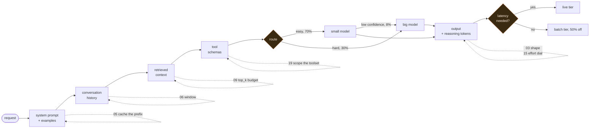
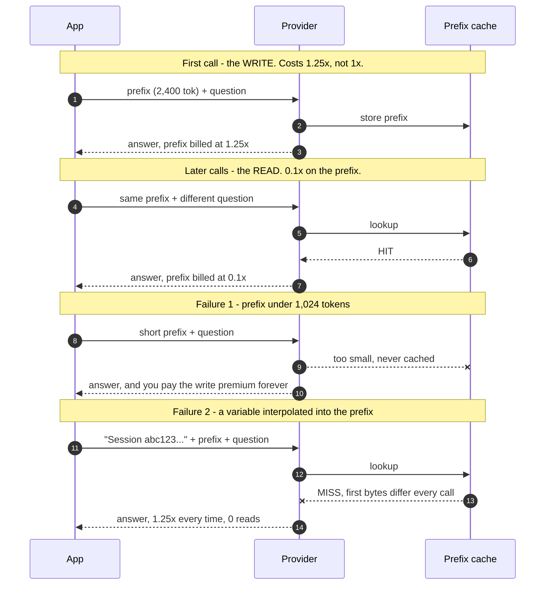
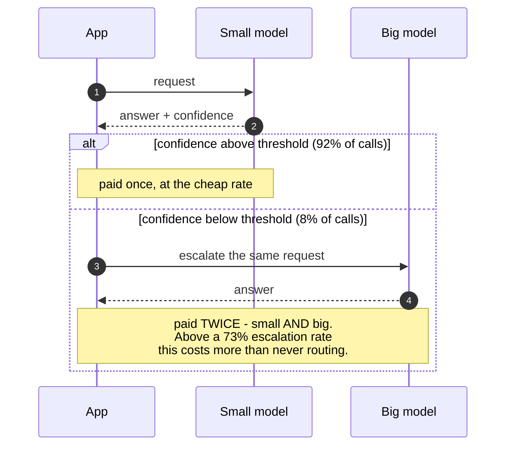
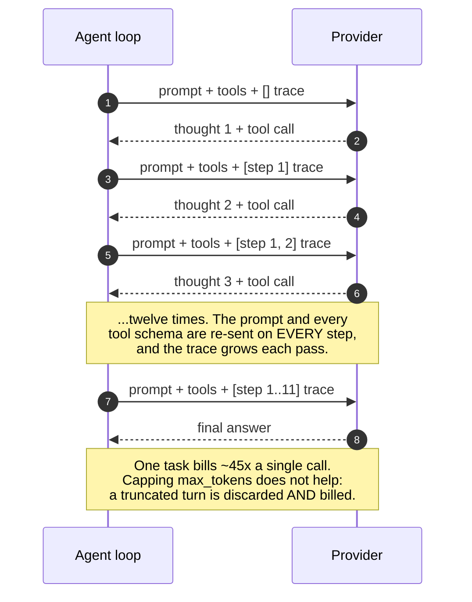
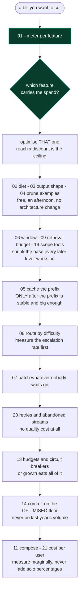

# LLM cost recipes

21 runnable Python recipes for reducing LLM API spend, and 6 tools that go with
them. Each prints **tokens reduced first, cost reduced second**, in that order, every
time.

**Python 3.9+. No dependencies, no install, no API key, no network.** Standard library
only -- `tiktoken` is used if it happens to be importable, otherwise a vendored
estimator runs and the banner says which.

```bash
python3 run_all.py --menu                 # pick one from a list
python3 run_all.py --summary              # the table below
python3 run_all.py --check                # CI gate: every recipe runs and reports
python3 recipes/05_cache_breakeven.py     # or run any one on its own
python3 tools/meter.py --demo             # each tool carries a --demo
```

### Run it against your own numbers

Nothing downstream is hardcoded, so overriding the rates or the volume
recomputes every figure in every recipe:

```bash
VOLUME=500000 python3 recipes/02_prompt_diet.py          # your traffic
VOLUME_SCALE=0.1 python3 run_all.py --summary            # a tenth of the defaults
PRICE_IN=2.50 PRICE_OUT=10 python3 run_all.py --summary  # your rate card
```

`VOLUME` sets an absolute requests-per-day; `VOLUME_SCALE` multiplies each
recipe's own default. The defaults differ per recipe on purpose -- a chat
workload and a nightly batch do not run at the same scale -- so the scale
factor is usually the more honest knob. Rates: `PRICE_IN`, `PRICE_OUT`,
`PRICE_IN_SMALL`, `PRICE_OUT_SMALL`.

### Three ways to run it without installing anything

- **Codespaces.** Open the repo, press `.` or use the Code button -> Codespaces.
  A container with Python is ready and the menu opens on attach.
- **From the Actions tab.** The `recipes` workflow has a **Run workflow** button
  that takes a recipe number, a volume and a rate card. The output is rendered
  in the run summary, so there is no log to dig through.
- **The browser demos.** `demos/` holds three self-contained pages -- no
  network, no build step.

  **GitHub shows these as source, not as pages.** They are static HTML, so the
  file view renders the markup. To actually see them, either open a Codespace
  (it serves `demos/` on port 8000 and offers to open it), or from a clone:

  ```bash
  open demos/playground.html            # macOS - no server needed
  xdg-open demos/playground.html        # Linux
  python3 -m http.server --directory demos   # or serve them all at :8000
  ```


| | |
|---|---|
| [`demos/index.html`](demos/index.html) | A year of one team's bill against the counterfactual, efficiency and growth indexed to a common base, and the self-hosting staircase. |
| [`demos/playground.html`](demos/playground.html) | A live burn meter, a playable lever game where the wrong order scores worse, a cost-incident mystery, and a museum of four optimisations where two quietly cost money. |
| [`demos/flow.html`](demos/flow.html) | Requests animating through the levers. **Parcel width is tokens, coins are cost** -- drawn apart because they are different quantities. Switch on the router and the parcels do not change while the coins halve. |

---

## Where the levers act

Every recipe operates on one part of a single request. Dotted arrows mark the lever
and the recipe that explains it.



---

## What it prints

```
==============================================================================
SUMMARY -- tokens first, cost second, for all 21 recipes
==============================================================================
  recipe                                tokens      cost   illustrative saving
  Tokens are the unit                     0.0%      0.0%                    --
  Put the system prompt on a diet       -61.9%    -34.0%             $4,401.00
  Shape the output, not just the inp    -23.3%    -52.5%             $7,222.50
  Prune the few-shot examples           -52.4%    -43.9%             $3,199.50
  Prompt caching and its break-even       0.0%    -37.7%            $25,434.00
  Window the conversation history       -39.6%    -35.2%            $45,864.00
  Move async work to the batch tier       0.0%    -41.1%           $161,460.00
  Route by difficulty, with a cascad      0.0%    -65.3%            $44,688.00
  Give retrieval a token budget         -81.8%    -72.5%            $48,438.00
  Agent loops, and the max_tokens tr    -46.8%    -38.2%            $13,459.50
  Compose the levers; stop adding pe    -68.1%    -94.3%           $194,706.00
  Self-hosting break-even                 0.0%      0.0%                    --
  Budgets, quotas and circuit breake     -0.0%    -61.6%            $35,343.00
  Committed use and forecasting           0.0%    -60.0%            $38,880.00
  Reasoning tokens and the effort di    -94.2%    -97.9%           $504,000.00
  The long-context price cliff            0.0%     -9.1%            $17,766.00
  Semantic caching and the wrong-ans    -18.0%    -18.0%             $6,557.18
  Prompt compression and who pays th    -64.5%     -0.3%               $208.80
  Tool schemas and the per-call tax     -85.5%    -80.7%           $130,680.00
  Retries, timeouts and abandoned st      0.0%     -6.8%             $5,657.71
  Cost per user and the unprofitable      0.0%    -46.9%            $67,767.00

  10 recipes cut ~0% of tokens. That is not a bug: caching, batch, routing,
  committed-use rates and self-hosting change what a token COSTS, not the count.
  The monthly figures use different volumes per recipe and DO NOT ADD UP --
  recipe 11 is the only one that composes levers against a single base.

  TOOLS: tools/bill_estimate.py, tools/cost_gate.py, tools/gateway.py, tools/instrument.py, tools/meter.py, tools/prefix_lint.py
  Each carries a --demo; cost_gate and prefix_lint are meant for CI.
```

---

## The one thing to understand before anything else

**Tokens and cost are two different quantities, and most of the money is in the
second one.**

Tokens are what an engineer changes: rewrite a prompt, drop a chunk, window a
history. Cost is tokens multiplied by someone else's price list, and a large part of
this set does not reduce tokens at all -- it changes the *rate* those tokens are
billed at.

That is why every recipe prints the token change first and the cost change second,
and why roughly half of them print `0.0%` in the token column while delivering most
of the saving. Caching, batching, routing, committed rates and the context cliff are
all price levers. Borrowing their cost saving into the token column is how a team
ends up counting the same prefix twice and reporting a saving it did not make.

Three consequences run through everything below:

1. **Cost per *completed task*, never cost per request.** A failed or truncated call
   costs full price and solves nothing. It is the only denominator under which
   `max_tokens` ranks correctly as a non-lever.
2. **Reach x discount is the ceiling.** A 90%-off lever on 2% of spend loses to a
   50%-off lever on everything. This is why recipe 01 comes first.
3. **Levers interact, and their percentages do not add.** Measured alone the levers
   in recipe 11 claim 180% off; run together the honest figure is 94%.

---

## How three of the mechanisms actually work

### Prompt caching -- and the three ways it pays nothing

A provider-side discount on a *prefix* that does not change between calls. The first
call writes the cache at a premium; later calls read it at a fraction. The arithmetic
is unforgiving in both directions.



### The routing cascade -- and the term everyone omits

Try the cheap model, escalate when confidence is low. The escalated share pays for
**both** models, which is what sets the ceiling on this lever.



### The agent loop -- why everything multiplies

An agent re-reads its own growing trace on every step, and re-sends every tool schema
with it.



---

## The recipes, in detail

### Measure first

You cannot optimise what you have not attributed. Every later recipe assumes this one has been run.

#### 01 &middot; [Tokens are the unit, and the average is a lie](recipes/01_the_unit.py)

**What it does.** Counts one real support request, then shows the distribution behind it.

**What it finds.** The mean cost per request is 3.3x the median and one call is 54% of total spend.

**What it costs you.** Nothing. It optimises nothing - it tells you WHERE to optimise. Reach x discount is the ceiling, and reach is the half specific to you.

### The free input-side work

An afternoon each, no architecture change, no quality risk beyond what the recipe names. Do these before anything structural.

#### 02 &middot; [Put the system prompt on a diet](recipes/02_prompt_diet.py)

**What it does.** Rewrites a system prompt that said the same thing three times.

**What it finds.** -62% tokens but only -34% cost, because the output is untouched and output costs 5x more.

**What it costs you.** Nothing. Free, safe, an afternoon - and still the small half of the bill.

#### 03 &middot; [Shape the output, not just the input](recipes/03_output_shape.py)

**What it does.** Changes the output contract: prose, then JSON, then a bare enum.

**What it finds.** -23% tokens but -53% cost. Output is where the money is.

**What it costs you.** The enum is cheapest and usually wrong to ship: no confidence score means no threshold, no review queue, and the misclassification cost lands off the token bill.

#### 04 &middot; [Prune the few-shot examples](recipes/04_few_shot_pruning.py)

**What it does.** Cuts the few-shot block from 8 examples to 2.

**What it finds.** -52% tokens, -44% cost, paid on every request forever.

**What it costs you.** Accuracy, at an exchange rate specific to your task. The recipe prints the eval procedure it cannot run for you: measure cost per CORRECT answer, not per request.

### The structural levers

These shrink the base every later lever works on, so they come before the pricing levers. Order matters inside this group too: window before you cache, because caching a history that grows every turn rewrites the cache every turn.

#### 05 &middot; [Prompt caching, and the three ways it pays nothing](recipes/05_cache_breakeven.py)

**What it does.** Puts a cache_control marker on a stable prefix and computes the break-even.

**What it finds.** Break-even is 0.28 hits - the FIRST hit repays the write premium 3.6x over, so the integer answer is 1. Stating 'you need two hits' rejects workloads that are already profitable.

**What it costs you.** Nothing, when it works. Three ways it pays nothing: a prefix under 1,024 tokens caches NOTHING; requests spaced wider than the TTL pay the write premium and collect no reads, which is strictly WORSE than no cache; and a variable interpolated into the prefix silently zeroes the hit rate.

#### 06 &middot; [Conversation history grows quadratically. Window it](recipes/06_history_window.py)

**What it does.** Windows a 20-turn conversation to the last six turns.

**What it finds.** A 20-turn conversation bills 6.8x the sum of its own turns, because every turn re-sends all the previous ones.

**What it costs you.** Recall. A user referring to something said twelve turns ago gets a model that has forgotten it. Summarise the dropped history rather than discarding it.

#### 09 &middot; [Give retrieval a token budget](recipes/09_rag_context_budget.py)

**What it does.** Cuts retrieval from top_k=20 to top_k=5 with reranking.

**What it finds.** -82% tokens. Embeddings are not the cost: they are paid once at index time, while twenty chunks per request are paid forever.

**What it costs you.** Usually nothing - it often improves answers, because fifteen irrelevant chunks dilute attention. Set k from an accuracy-vs-k curve, and keep retrieved context AFTER the stable prefix or you break caching.

#### 19 &middot; [Tool schemas: the tax you pay on every call, used or not](recipes/19_tool_schemas.py)

**What it does.** Loads 8, 20, then 54 tool schemas into the same request.

**What it finds.** At 54 tools the schema is 96.8% of the input and costs +906%. In a 12-step agent that is 324,000 tokens of type definitions for one task.

**What it costs you.** Nothing to fix - scope the toolset per feature and it is pure win. But note what it means: adding ONE heavy tool costs ~$4,050/month at 60k req/day, paid on every request including the ~95% that never call it. A PR that adds a tool is a pricing change.

### The price levers

These change what a token costs rather than how many you send. Their token column prints 0% and they carry most of the money.

#### 07 &middot; [Move what nobody is waiting for to the batch tier](recipes/07_batch_async.py)

**What it does.** Moves work nobody is waiting on to the async tier.

**What it finds.** 50% off both directions for 82% of traffic. No prompt change, no model change, no accuracy change, zero tokens saved.

**What it costs you.** Latency, as a service-level commitment rather than a number. You need a queue, retries and a partial-failure path before moving production traffic. On some providers caching and batch do not compose.

#### 08 &middot; [Route by difficulty, and pay twice when you are wrong](recipes/08_model_routing.py)

**What it does.** Tries a small model first and escalates on low confidence.

**What it finds.** The escalated share pays BOTH models. The cascade stops saving entirely above a 73% escalation rate - the term every routing estimate leaves out.

**What it costs you.** Accuracy on the routed share, plus the escalations. Measure your real escalation rate before promising a number.

#### 16 &middot; [The long-context price cliff: one token, double the bill](recipes/16_context_cliff.py)

**What it does.** Walks input size across the long-context threshold.

**What it finds.** A STEP, not a slope: one extra token at the threshold re-prices the ENTIRE request. +100% for 0.0005% more tokens.

**What it costs you.** Nothing - but you must watch the distribution, not the mean. A mean of 150k says nothing about the 5% sitting at 205k, and those carry the whole penalty. Vendors differ; at least one bills a 1M window at standard rates.

#### 17 &middot; [Semantic caching: 100% off, and the only lever that can be wrong](recipes/17_semantic_cache.py)

**What it does.** Serves cached answers to semantically similar questions.

**What it finds.** The largest discount available - it skips the call entirely - and the ONLY lever here that can hand a user an answer to a question they did not ask. At the loosest threshold: 71% saving and 9,841 wrong answers a day.

**What it costs you.** Correctness. Idempotent factual lookups only, short TTLs, never anything user-specific or time-sensitive. Grade real hits by hand; no similarity score substitutes for that.

### The output side

Output is billed at roughly 5x input, and reasoning tokens land there while never being returned to you.

#### 15 &middot; [Reasoning tokens: billed as output, and you never see them](recipes/15_reasoning_budget.py)

**What it does.** Sweeps the reasoning effort dial from off to maximum.

**What it finds.** Thinking tokens are billed as OUTPUT - the expensive side - and never returned. Maximum effort is 48x the cost of off.

**What it costs you.** Accuracy, and the trade depends entirely on what a failure costs. Price a failure at $0 and 'off' wins; at $0.50 the optimum moves to medium; at $5 to high. The token bill cannot see that column.

#### 18 &middot; [Automated prompt compression, and the call that does the work](recipes/18_prompt_compression.py)

**What it does.** Compresses a 9,000-token context with a model call.

**What it finds.** The compressor is itself billed. Compressing on every request saves 0.3% - it costs 0.99x what it saves. The win only arrives on REUSE.

**What it costs you.** Quality, and determinism. A compressor whose output varies run to run gives you an unstable prefix, which breaks caching and costs the write premium forever. Compress once, store it, cache that.

### The multiplier

Agents re-read their own trace, so every other number in this set gets multiplied.

#### 10 &middot; [Agent loops multiply everything, and max_tokens is not a lever](recipes/10_agent_loops.py)

**What it does.** Runs a 12-step agent loop that re-reads its own trace every step.

**What it finds.** One task bills 45x a single call. Then the trap: capping max_tokens leaves the bill unchanged and raises cost per SOLVED task 18%, because a truncated turn is discarded and still billed.

**What it costs you.** max_tokens is invisible to the model, so it cannot plan around it. Set it high, alert on stop_reason == max_tokens as a FAILURE, and economise with budgets the model can actually see.

### The decisions above the code

Composition, build-versus-buy, keeping growth from eating the gains, buying the rate down, the work that produces nothing, and whether a customer is profitable at all.

#### 11 &middot; [Compose the levers, and stop adding their percentages up](recipes/11_the_stack.py)

**What it does.** Switches all four levers on against one request shape.

**What it finds.** The four solo percentages sum to 180% off. Run them together and the real figure is 94%. The gap is what double counting looks like.

**What it costs you.** Nothing - but it refuses to let you quote its own 94%, because that number is an artifact of its inputs. The mechanism transfers; the number does not.

#### 12 &middot; [Self-hosting: the break-even moves when you optimise first](recipes/12_selfhost_breakeven.py)

**What it does.** Models self-hosting with GPU count driven by capacity.

**What it finds.** Cost is a STAIRCASE, not a curve: at 110k->120k req/day demand rises 9% and cost per request RISES, because the third GPU starts idle. Break-even is 220k req/day at list rate - and NEVER once you have optimised, because a fully loaded GPU's floor sits above the optimised managed price.

**What it costs you.** Opportunity cost, specialist skills, no native caching, a weaker model, and an on-call rotation. The hybrid - self-host the steady high-volume tail, route the rest - is usually the real answer.

#### 13 &middot; [Governance: every optimisation gain gets eaten by growth](recipes/13_governance_budgets.py)

**What it does.** Applies a 45% per-request cut, then lets the service grow for six months.

**What it finds.** The optimisation worked and held. The bill is still 2.4x higher by month six. The invoice cannot tell efficiency from growth.

**What it costs you.** Governance is a control, not a discount - it moves no number by itself. A downgrade at 80% of budget serves every request at lower quality; a hard stop protects the budget and refuses real users.

#### 14 &middot; [Optimisation reduces volume; negotiation reduces rate](recipes/14_commit_and_forecast.py)

**What it does.** Sizes a committed-use discount against an optimised baseline.

**What it finds.** Optimisation cuts volume, negotiation cuts rate; 50% and 20% compose to 60% off. Commit on PRE-optimisation volume and you strand the difference - $311k/year for tokens you no longer send.

**What it costs you.** Flexibility. Commit to the conservative band of the forecast and leave the uncertain tail on pay-as-you-go: list rate on the tail is cheaper than a stranded commitment on the base.

#### 20 &middot; [Retries, timeouts and abandoned streams: paying for nothing](recipes/20_waste_paths.py)

**What it does.** Prices the requests that produce nothing: failures, timeouts, abandoned streams.

**What it finds.** 10% of spend buys nothing. A client timeout on work that COMPLETED is billed in full, and the retry pays twice. SDK retries 3 x app retries 3 = 9 billed attempts, and nobody wrote '9' anywhere.

**What it costs you.** NOTHING. This is the only lever in the set with no quality trade at all - it is work nobody received. Lengthen timeouts before adding retries, send idempotency keys, own retries in exactly one layer, propagate cancellation.

#### 21 &middot; [Cost per user, and the ones who cost more than they pay](recipes/21_unit_economics.py)

**What it does.** Puts cost against revenue per user instead of per request.

**What it finds.** Gross margin reads 86% and looks healthy. Underneath, 1.5% of accounts are sold below cost and destroy $41,202/month. The extreme band pays $20 and costs $295.80.

**What it costs you.** Flat price against usage-based cost is structural, and it gets WORSE with scale because growth recruits more of the tail. Route the heavy users to cheaper delivery before capping them - they are also your most engaged.


---

## Order of operations

Not a preference. Each step shrinks the base the next one works on, and two pairs
conflict outright if you take them in the wrong order.



---

## Quick index

| # | |
|---|---|
| [01](recipes/01_the_unit.py) | Tokens are the unit, and the average is a lie |
| [02](recipes/02_prompt_diet.py) | Put the system prompt on a diet |
| [03](recipes/03_output_shape.py) | Shape the output, not just the input |
| [04](recipes/04_few_shot_pruning.py) | Prune the few-shot examples |
| [05](recipes/05_cache_breakeven.py) | Prompt caching, and the three ways it pays nothing |
| [06](recipes/06_history_window.py) | Conversation history grows quadratically. Window it |
| [07](recipes/07_batch_async.py) | Move what nobody is waiting for to the batch tier |
| [08](recipes/08_model_routing.py) | Route by difficulty, and pay twice when you are wrong |
| [09](recipes/09_rag_context_budget.py) | Give retrieval a token budget |
| [10](recipes/10_agent_loops.py) | Agent loops multiply everything, and max_tokens is not a lever |
| [11](recipes/11_the_stack.py) | Compose the levers, and stop adding their percentages up |
| [12](recipes/12_selfhost_breakeven.py) | Self-hosting: the break-even moves when you optimise first |
| [13](recipes/13_governance_budgets.py) | Governance: every optimisation gain gets eaten by growth |
| [14](recipes/14_commit_and_forecast.py) | Optimisation reduces volume; negotiation reduces rate |
| [15](recipes/15_reasoning_budget.py) | Reasoning tokens: billed as output, and you never see them |
| [16](recipes/16_context_cliff.py) | The long-context price cliff: one token, double the bill |
| [17](recipes/17_semantic_cache.py) | Semantic caching: 100% off, and the only lever that can be wrong |
| [18](recipes/18_prompt_compression.py) | Automated prompt compression, and the call that does the work |
| [19](recipes/19_tool_schemas.py) | Tool schemas: the tax you pay on every call, used or not |
| [20](recipes/20_waste_paths.py) | Retries, timeouts and abandoned streams: paying for nothing |
| [21](recipes/21_unit_economics.py) | Cost per user, and the ones who cost more than they pay |

---

## The tools

The recipes teach a mechanism; the tools are what you paste into your own system.
Each carries a `--demo`.

| | Where it runs | What it does |
|---|---|---|
| [`meter.py`](tools/meter.py) | your app | Per-feature token and cost metering, reporting cost per *solved* call. Keeps cached input tokens as their own field, because a meter that sums raw input overstates any cached workload. |
| [`cost_gate.py`](tools/cost_gate.py) | CI | Counts tokens in every prompt template against a committed baseline and fails the build past a tolerance. Its demo blocks a PR titled "just adding a bit of guidance" at +867%. |
| [`prefix_lint.py`](tools/prefix_lint.py) | CI | Finds the first per-request variable in a template and reports the stable tokens stranded behind it. Refuses to quote a saving when the whole template is under the cache minimum. |
| [`gateway.py`](tools/gateway.py) | your proxy | Response cache, budget, model downgrade and hard stop, in the order a request meets them. A response cache is **not** prompt caching: it skips the call and can answer a new question with an old answer. |
| [`instrument.py`](tools/instrument.py) | your numbers | Decides whether a saving is real: successful-output denominator, normalisation, counterfactual, incremental attribution, quality floor. Most of its value is in what it refuses to certify. |
| [`bill_estimate.py`](tools/bill_estimate.py) | your CSV | Ranks the levers by reach x discount against your own traffic. A missing required column is an error naming it, never a default. |

---

## What is measured, and what is assumed

This distinction is the point of the whole set.

- **Measured when you run it.** Every token count and every percentage. The prompts
  are in the files; change one and the result changes. Nothing is hardcoded from a
  slide or a blog post.
- **Published provider mechanics.** Cache read and write multipliers, the
  1,024-token minimum, the batch discount, the long-context step, the output
  premium. These live in `recipes/prices.py` and drive every result here.
- **Illustrative rates.** `$3/$15` per 1M for the big model, `$0.80/$4.00` for the
  small one. **Not a quote.** Confirm against live pricing before putting a dollar
  figure in front of anyone.
- **Stated assumptions.** Volumes, growth rates, quality penalties, truncation and
  escalation shares. Each is labelled in the file that uses it.

The monthly dollar figures use a **different volume per recipe** and **do not add
up**. Recipe 11 is the only one that composes levers against a single base; use it,
not the sum, for anything resembling a forecast.

---

## Rules these files keep

- **No savings percentage is quoted as achievable.** Recipe 11 computes 94% off from
  its own inputs and then tells you, in the file, not to repeat it.
- **Every lever names what it costs you** -- accuracy, recall, escalations, latency,
  correctness, flexibility. A lever with no stated cost has not been thought about.
- **Caching arithmetic is vendor-specific.** Some providers bill a cache write at a
  premium; at least one bills it at standard price and charges time-based storage
  instead, which removes the break-even entirely.
- **Two recipes report no saving at all** and are among the most useful here. A set
  that only showed wins would be the kind of claim this material exists to criticise.

---

## Licence

Copyright (c) 2026 ClearRoute. All rights reserved. Proprietary; no licence is
granted. See [LICENSE](LICENSE).
